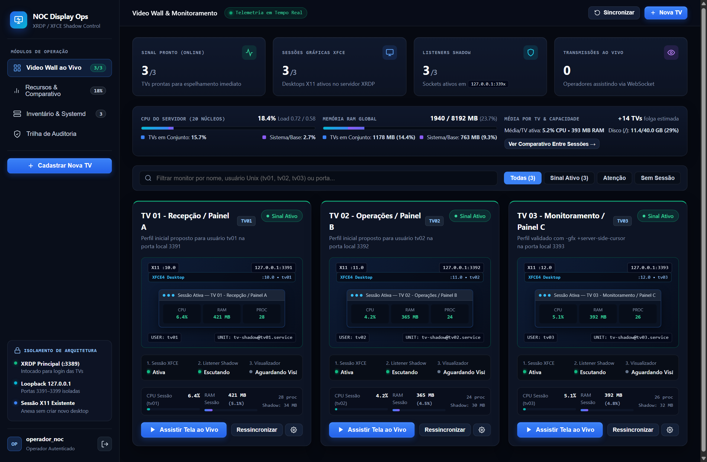
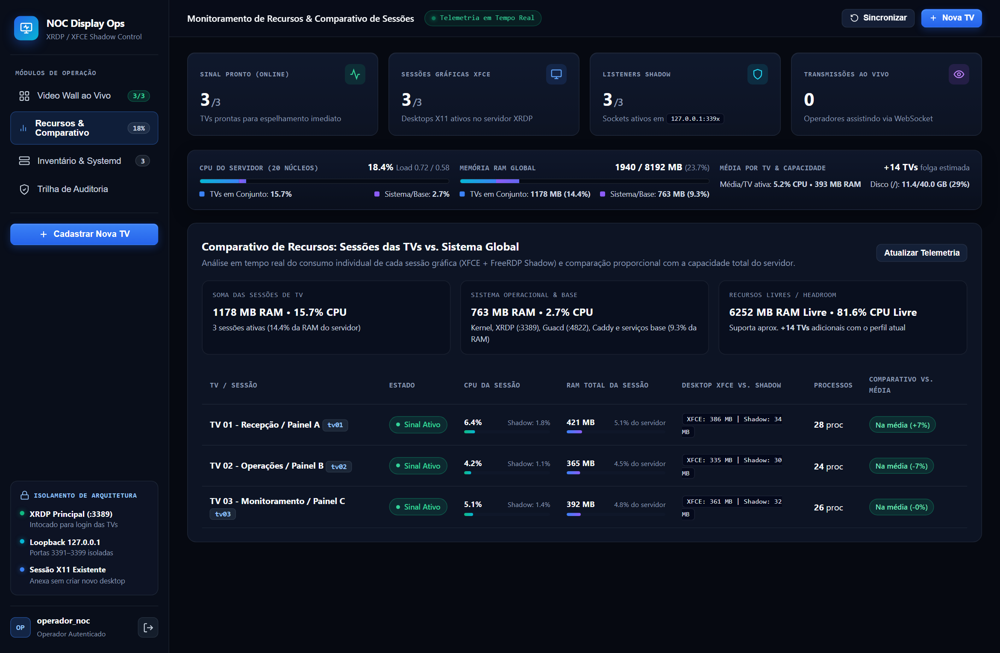
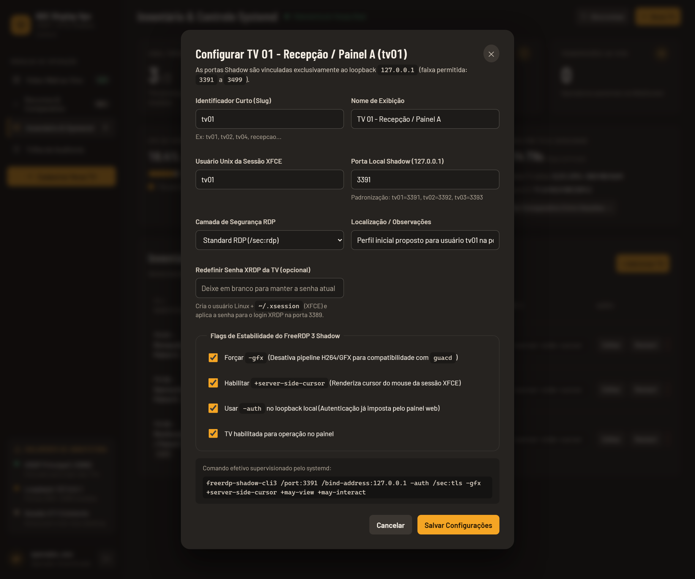
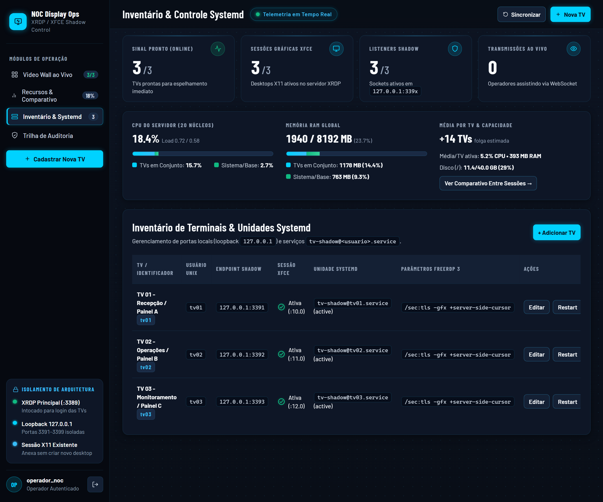
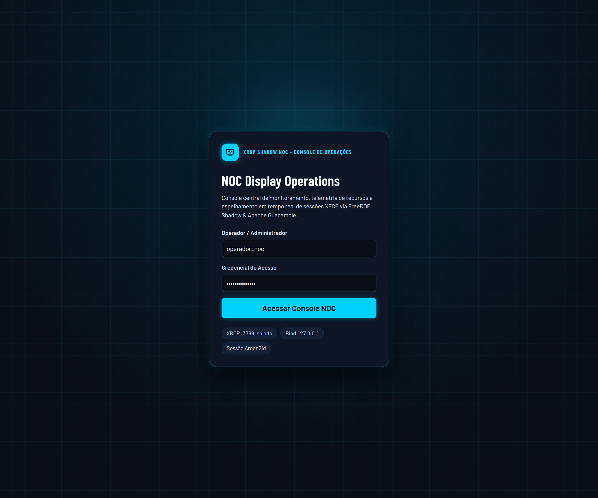
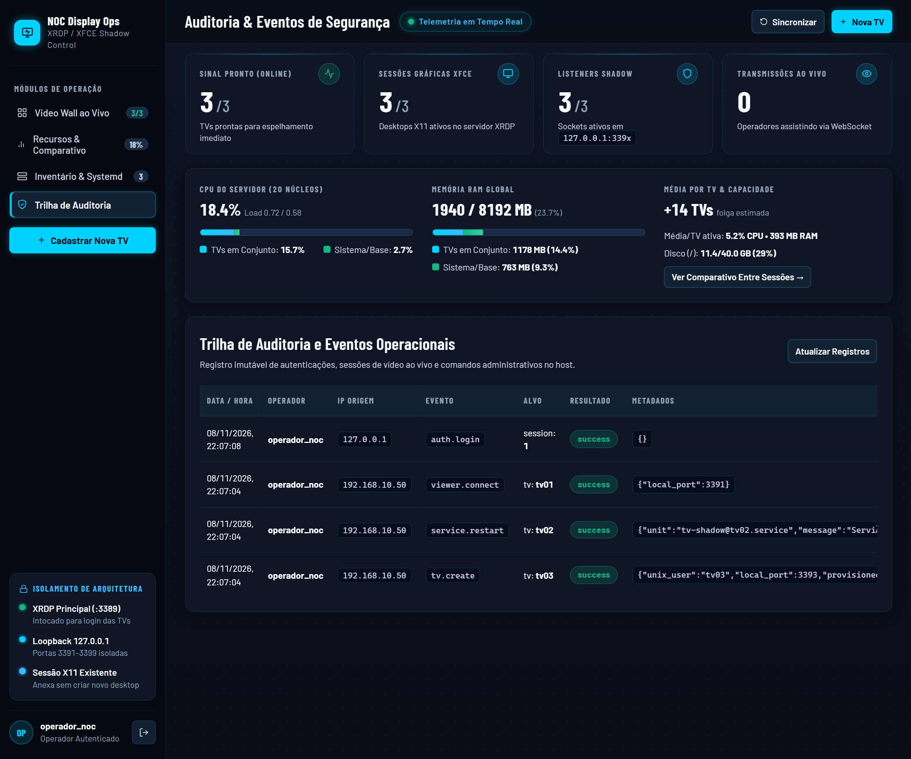

# 🖥️ NOC Display Ops — Painel Web de Espelhamento e Gerenciamento XRDP / XFCE

Painel web centralizado para **monitorar, gerenciar e espelhar em tempo real pelo navegador** as sessões gráficas de TVs corporativas conectadas via **XRDP** em servidores Linux (Ubuntu e Debian), com **zero interferência na TV física** e sem criar novas sessões gráficas.

Compatível nativamente com **Ubuntu 22.04 LTS / 24.04 LTS** e **Debian 12 ("Bookworm") / Debian 13 ("Trixie")**.

---

## 💡 Para Que Serve Este Projeto?

### ❓ O Problema
Em muitas empresas, salas de operação, call centers e centros de monitoramento (NOC), existem diversas **TVs nas paredes conectadas a um servidor Linux via XRDP** exibindo dashboards (Zabbix, Grafana, câmeras de segurança, métricas de vendas, etc.).

Quando surge um problema ou quando alguém precisa verificar o que está passando em uma TV:
- Se você tentar conectar na mesma conta via RDP comum (porta `3389`), o XRDP **derruba a sessão da TV física** ou abre um segundo desktop vazio.
- Não é possível saber se o dashboard da TV travou sem ir **fisicamente até a sala** olhar a tela.
- Cadastrar uma nova TV ou trocar uma senha exige abrir terminal SSH, criar usuário no Linux manualmente (`useradd`), configurar `.xsession` e gerenciar processos na mão.

### ✅ A Solução
O **NOC Display Ops** resolve isso criando uma ponte web inteligente:
1. **Espelha a Tela Real ao Vivo**: O operador abre o navegador e vê exatamente o que a TV física está exibindo em tempo real (60 FPS, HTML5 puro), sem desconectar a TV e sem abrir sessão extra.
2. **Video Wall no Navegador**: Visualize todas as TVs da empresa em uma única tela, com miniaturas ativas e status de conexão.
3. **Gerenciamento sem Terminal**: Crie novas TVs, defina senhas do XRDP e reinicie sessões travadas diretamente pela interface web com 1 clique.

---

## ✨ Principais Funcionalidades

| Recurso | Descrição |
| :--- | :--- |
| 👁️ **Espelhamento ao Vivo (HTML5)** | Transmissão de vídeo em tempo real via WebSockets + Apache Guacamole, sem nenhum plugin ou cliente instalado. |
| 🛡️ **Zero Interferência na TV Física** | Utiliza o FreeRDP Shadow isolado em portas locais (`127.0.0.1:3391..3499`). A porta principal do XRDP (`:3389`) permanece 100% intocada. |
| 🖥️ **Video Wall com Miniaturas** | Grid interativo com pré-visualização ao vivo de todas as TVs, estilo máquina virtual, com abertura em tela cheia sob demanda. |
| 👤 **Provisionamento de TVs e Senhas** | Ao cadastrar uma TV no painel, o sistema cria o usuário Linux (`useradd`), configura a sessão XFCE (`~/.xsession`) e define a senha do XRDP (`chpasswd`) automaticamente. |
| 📊 **Telemetria de CPU & Memória** | Monitora em tempo real quanto de processador e memória cada TV está consumindo, alertando sobrecarga e travamentos. |
| 🔧 **Controle de Serviços Systemd** | Inicie, reinicie ou pare o serviço gráfico de qualquer TV (`tv-shadow@<usuario>.service`) diretamente pelo painel web. |
| 🔒 **Segurança & Trilha de Auditoria** | Login protegido com PBKDF2-HMAC-SHA256 (600.000 iterações), proteção contra força bruta, tokens CSRF e registro de todos os acessos e comandos. |

---

## 📸 Demonstração Visual (Screenshots)

### 1. Video Wall & Monitores de Rede (Painel Principal)
Visão geral de todos os terminais com miniaturas em tempo real, telemetria de hardware e LEDs de porta de switch:


---

### 2. Monitoramento de Recursos & Comparativo entre Sessões
Compara o consumo de CPU e RAM de cada sessão gráfica individual contra os recursos globais do servidor:


---

### 3. Cadastro de TVs & Troca de Senha XRDP
Cadastre uma nova TV ou troque a credencial de acesso sem precisar digitar comandos no terminal Linux:


---

### 4. Inventário de Terminais & Serviços Systemd
Controle centralizado dos serviços `tv-shadow@<usuario>.service` (`Iniciar`, `Reiniciar`, `Parar`) e portas de rede locais:


---

### 5. Console de Autenticação & Trilha de Auditoria
Acesso seguro para a equipe de operações com registro detalhado de eventos e conexões:

| Console de Login NOC | Trilha de Auditoria e Eventos |
| :---: | :---: |
|  |  |

> 📊 Para ver a evolução da interface e métricas de acessibilidade, consulte o [Comparativo Antes × Depois (HTML Estático)](./docs/redesign/before-after.html).

---

## ⚡ Instalação Rápida no Servidor Linux

### Requisitos Mínimos
- Servidor com **Ubuntu 22.04 / 24.04 LTS** ou **Debian 12 / 13**.
- XRDP e XFCE instalados (o servidor já deve aceitar logins XRDP na porta `3389`).

### Instalação Automatizada em 1 Passo

Execute no terminal do seu servidor como `root`:

```bash
# 1. Clonar o repositório
git clone https://github.com/JoseVitor-net/panel-web-server-XRDP.git /home/user/panel-web-server-XRDP
cd /home/user/panel-web-server-XRDP

# 2. Executar o instalador automático (Ubuntu 24.04 / 22.04)
sudo bash deploy/scripts/install-ubuntu2404.sh
```
*(Se estiver utilizando **Debian 12 ou 13**, execute: `sudo bash deploy/scripts/install-debian13.sh`).*

O instalador automático cuida de tudo:
- Instala pacotes do sistema (`guacd`, `nodejs`, `npm`, `caddy`, `freerdp-shadow-x11`).
- Compila a interface gráfica web React/TypeScript.
- Cria o ambiente seguro Python em `/opt/tv-panel` com banco de dados SQLite.
- Configura as regras de permissão restrita no `sudoers` e as unidades do `systemd`.
- Inicia o proxy reverso Caddy com suporte a HTTPS e WebSockets.

---

## 👤 Primeiro Acesso ao Painel

Após a instalação, crie a senha do seu usuário administrador:

```bash
cd /opt/tv-panel/backend
sudo -u tv-panel TV_PANEL_DB_PATH=/var/lib/tv-panel/tv_panel.db \
  /opt/tv-panel/venv/bin/python -m app.cli create-admin --username operador_noc
```

Em seguida, acesse no navegador:
```
https://IP-DO-SEU-SERVIDOR
```
Faça login com o usuário `operador_noc` e a senha definida.

---

## 🛠️ Como Cadastrar uma TV e Conectar no XRDP

1. No painel web, clique em **"+ Nova TV"**.
2. Preencha os campos:
   - **Identificador (`slug`)**: ex. `tv01`
   - **Nome da TV**: ex. `TV 01 - Monitoramento NOC`
   - **Usuário Unix**: ex. `tv01`
   - **Porta Local Shadow**: ex. `3391`
   - **Senha do XRDP**: defina a senha da conta.
3. Clique em **"Salvar Configurações"**. O sistema cria o usuário no Linux e prepara a sessão XFCE automaticamente.
4. Na TV física (ou cliente RDP), conecte no IP do servidor (porta `3389`) utilizando o usuário `tv01` e a senha definida.
5. Assim que a TV conectar, o painel web exibirá o status **ONLINE** e a transmissão ao vivo aparecerá na tela do navegador!

---

## 🔄 Como Atualizar o Sistema no Servidor

Sempre que sair uma nova atualização no repositório GitHub, execute no servidor:

```bash
cd /home/user/panel-web-server-XRDP
git fetch origin
git reset --hard origin/main

# Recompilar frontend com novos recursos
cd frontend
npm install
npm run build
rm -rf /opt/tv-panel/frontend/dist
cp -r dist /opt/tv-panel/frontend/

# Atualizar backend e reiniciar
cd ..
cp -r backend/app /opt/tv-panel/backend/
systemctl daemon-reload
systemctl restart tv-panel-api.service
```

---

## 🏗️ Como Funciona por Baixo dos Panos (Arquitetura)

```mermaid
flowchart LR
    subgraph TVs["TVs Físicas (Clientes RDP)"]
        TV1["TV 01 (Display Físico)"]
    end

    subgraph Linux["Servidor Linux"]
        XRDP["xrdp :3389 (Porta Padrão Intocada)"]
        X11["Sessão XFCE (:10.0)"]
        SHADOW["FreeRDP Shadow (127.0.0.1:3391)"]
        GUACD["Apache guacd (127.0.0.1:4822)"]
        API["FastAPI Backend (127.0.0.1:8000)"]
        CADDY["Caddy Reverse Proxy (:443 HTTPS)"]
    end

    subgraph Browser["Operadores NOC (Navegador)"]
        CLIENT["Dashboard Web (Canvas HTML5)"]
    end

    TV1 -->|Porta 3389| XRDP --> X11
    X11 ---|Memória Compartilhada| SHADOW
    SHADOW <-->|Loopback Local| GUACD
    GUACD <-->|Instruções Guacamole| API
    API <-->|WebSocket Criptografado| CADDY <--> CLIENT
```



- **Isolamento Total**: O FreeRDP Shadow e o `guacd` escutam **apenas em `127.0.0.1`** (loopback local fechado). Eles não ficam expostos na rede externa.
- **Leitura Direta da Memória (MIT-SHM)**: O shadow conecta diretamente na sessão gráfica X11 existente da TV através de memória compartilhada, sem gastar processamento com renderização secundária.
- **Zero Delay**: O tráfego para o navegador usa WebSockets com instruções compactas do protocolo Guacamole, desenhando os pixels diretamente na GPU do navegador via `<canvas>`.

---

## 🔍 Comandos Úteis de Diagnóstico

```bash
# Diagnóstico completo das sessões XFCE, portas e banco de dados
cd /opt/tv-panel/backend
sudo -u tv-panel TV_PANEL_DB_PATH=/var/lib/tv-panel/tv_panel.db \
  /opt/tv-panel/venv/bin/python -m app.cli diagnose

# Verificar se as portas locais de Shadow e guacd estão ativas
ss -tlnp | grep -E '3389|339[1234]|4822|8000'

# Ver logs da API web
journalctl -u tv-panel-api.service -n 50 --no-pager

# Ver logs do serviço de espelhamento de uma TV específica
journalctl -u tv-shadow@tv01.service -n 50 --no-pager
```

---

## 📄 Licença
Distribuído sob a licença MIT. Consulte `LICENSE` para mais detalhes.
