# 🖥️ NOC Display Operations — Painel Web de Espelhamento e Gerenciamento XRDP / XFCE Shadow

Console web completo (**FastAPI + SQLite + React/TypeScript + Apache Guacamole HTML5 + Systemd**) para monitorar, gerenciar e espelhar em tempo real pelo navegador as sessões gráficas **XFCE4** de TVs corporativas conectadas via **XRDP**, sem criar novas sessões gráficas e sem interferir na porta `3389`.

Compatível nativamente com **Ubuntu 22.04 LTS / 24.04 LTS** e **Debian 12 ("Bookworm") / Debian 13 ("Trixie")**.

> 📊 **Design & Acessibilidade NOC**: Interface em padrão *sala de controle profissional* (grafite quente, tipografia Barlow, contraste WCAG AA e status com diferenciação por forma de ícone + cor). Veja o [comparativo visual antes × depois](./docs/redesign/before-after.html).

---

## 📸 Visão Geral do Sistema (Screenshots)

### 1. Video Wall ao Vivo & Telemetria em Tempo Real
Painel principal com **pré-visualização 16:9 ao vivo** de cada TV (estilo miniatura VirtualBox), indicadores de estado independentes (*Sessão XFCE*, *Listener Shadow*, *Visualizador*) e telemetria de recursos (**CPU, Memória RAM, Processos e Capacidade de Expansão**).


---

### 2. Monitoramento de Recursos & Comparativo entre Sessões
Compara em tempo real o consumo individual de CPU e Memória RAM de cada sessão gráfica (`xfce4-session` + `freerdp-shadow-cli`) com o consumo global do servidor Linux, estimando automaticamente quantas TVs adicionais o hardware suporta com segurança.


---

### 3. Cadastro de TVs, Provisionamento Automático de Usuário Linux e Senha XRDP
Ao cadastrar uma nova TV ou editar uma existente pelo painel web, o sistema **cria automaticamente o usuário Linux correspondente** (`useradd -m`), configura o `~/.xsession` (`xfce4-session`), **define ou altera a senha do XRDP** (`chpasswd`) e habilita o serviço `tv-shadow@<usuario>.service`.


---

### 4. Inventário de Terminais & Controle de Serviços `systemd`
Gerenciamento centralizado das unidades `tv-shadow@<usuario>.service` (`Start`, `Restart`, `Stop`) e inspeção das portas locais de loopback (`127.0.0.1:3391..3499`).


---

### 5. Autenticação Segura & Trilha de Auditoria
Acesso protegido com hash **PBKDF2-HMAC-SHA256 (600.000 iterações)**, bloqueio automático contra força bruta, proteção CSRF e registro de auditoria de logins, conexões de vídeo ao vivo e alterações administrativas.

| Console de Login NOC | Trilha de Auditoria e Eventos |
| :---: | :---: |
|  |  |

---

## 🏗️ Arquitetura e Isolamento de Segurança

```mermaid
flowchart LR
    subgraph TV["TVs Corporativas (Clientes RDP)"]
        TV1["TV 01 (Login tv01)"]
        TV2["TV 02 (Login tv02)"]
    end

    subgraph Host["Servidor Linux (Ubuntu 22.04/24.04 ou Debian 12/13)"]
        XRDP["xrdp :3389 (Intocado)"]
        X11_1["Sessão XFCE :10.0 (tv01)"]
        X11_2["Sessão XFCE :11.0 (tv02)"]
        SH1["freerdp-shadow-cli (127.0.0.1:3391)"]
        SH2["freerdp-shadow-cli (127.0.0.1:3392)"]
        GUACD["guacd 1.5.5 (127.0.0.1:4822)"]
        API["FastAPI Backend + React UI (127.0.0.1:8000)"]
        PROXY["Caddy / Nginx Reverse Proxy (HTTP/HTTPS)"]
    end

    subgraph Operador["Operador NOC (Navegador Web)"]
        WEB["Console Web (Miniatura 16:9 + Tela Cheia)"]
    end

    TV1 -->|RDP :3389| XRDP --> X11_1
    TV2 -->|RDP :3389| XRDP --> X11_2
    X11_1 ---|Captura X11| SH1
    X11_2 ---|Captura X11| SH2
    SH1 & SH2 <-->|Loopback 127.0.0.1| GUACD
    GUACD <-->|Protocolo Guacamole| API
    API <-->|WebSocket /api/ws/tv/id| PROXY <--> WEB
```



### Pilares da Arquitetura
1. **XRDP Principal (`:3389`) 100% Intocado**: O painel jamais reinicia o `xrdp.service` nem desconecta as TVs.
2. **Anexação à Sessão X11 Existente**: O wrapper `/usr/local/libexec/tv-panel/tv-shadow-launch.sh` descobre dinamicamente o socket `/tmp/.X11-unix/X*` (`:10.0`, `:11.0`, etc.) e o cookie `XAUTHORITY` da sessão XFCE já aberta pela TV.
3. **Confinamento Estrito em `127.0.0.1`**: Os servidores `freerdp-shadow` (`127.0.0.1:3391..3499`) e o daemon `guacd` (`127.0.0.1:4822`) escutam exclusivamente na interface de loopback local.
4. **Suporte Híbrido Automático**: Funciona tanto quando a própria TV inicia o `freerdp-shadow-cli` dentro da sessão quanto via unidade `systemd` `tv-shadow@<usuario>.service`.

---

## 🐧 Compatibilidade de Sistemas Operacionais (Ubuntu & Debian)

O instalador ([`deploy/scripts/install-debian13.sh`](./deploy/scripts/install-debian13.sh)) e o wrapper ([`deploy/scripts/tv-shadow-launch.sh`](./deploy/scripts/tv-shadow-launch.sh)) detectam automaticamente a distribuição Linux e a versão do FreeRDP instalada:

| Sistema Operacional | Pacote FreeRDP Detectado | Binário Utilizado | Status |
| :--- | :--- | :--- | :--- |
| **Ubuntu 24.04 LTS ("Noble")** | `freerdp2-shadow-x11` (ou `freerdp3-shadow-x11`) | `/usr/bin/freerdp-shadow-cli` / `freerdp-shadow-cli3` | ✅ **100% Compatível** |
| **Ubuntu 22.04 LTS ("Jammy")** | `freerdp2-shadow-x11` | `/usr/bin/freerdp-shadow-cli` | ✅ **100% Compatível** |
| **Debian 13 ("Trixie")** | `freerdp3-shadow-x11` | `/usr/bin/freerdp-shadow-cli3` | ✅ **100% Compatível** |
| **Debian 12 ("Bookworm")** | `freerdp2-shadow-x11` | `/usr/bin/freerdp-shadow-cli` | ✅ **100% Compatível** |

---

## 🚀 Guia de Instalação Passo a Passo (Ubuntu & Debian)

### Passo 1: Instalar dependências de base (Ubuntu 22.04/24.04 ou Debian 12/13)
Se o seu servidor **Ubuntu** ou **Debian** já possui XRDP e XFCE funcionando, instale apenas o Node.js, Git e Docker. Caso esteja começando em um servidor limpo, execute:

```bash
sudo apt-get update
sudo apt-get install -y \
  xrdp xfce4 xfce4-goodies dbus-x11 \
  git curl ca-certificates nodejs npm \
  docker.io

# No Ubuntu/Debian, garante que o usuário xrdp possa ler o certificado TLS:
sudo adduser xrdp ssl-cert || true
sudo systemctl enable --now xrdp
sudo systemctl enable --now docker
```

> **Dica para Ubuntu 22.04 / 24.04:** Caso o pacote `docker-compose-v2` ou `docker-compose-plugin` esteja disponível via APT, instale-o com:
> ```bash
> sudo apt-get install -y docker-compose-v2 || sudo apt-get install -y docker-compose
> ```

---

### Passo 2: Clonar o Repositório e Compilar o Frontend
```bash
sudo git clone https://github.com/JoseVitor-net/panel-web-server-XRDP.git /opt/server-rdp
cd /opt/server-rdp/frontend
npm install
npm run build
cd /opt/server-rdp
```

---

### Passo 3: Executar o Instalador do Backend, Scripts e Unidades `systemd`
O script instala automaticamente `freerdp2-shadow-x11` (no Ubuntu / Debian 12) ou `freerdp3-shadow-x11` (no Debian 13), cria o ambiente virtual Python em `/opt/tv-panel`, aplica as migrações SQLite, configura a regra restrita do `sudoers` e ativa o serviço `tv-panel-api.service`:

```bash
sudo bash deploy/scripts/install-debian13.sh
```

---

### Passo 4: Subir o Gateway `guacd` em Loopback (`127.0.0.1:4822`)
Utilizamos a imagem oficial estável `guacamole/guacd:1.5.5` em `network_mode: host` vinculada exclusivamente a `127.0.0.1:4822`:

```bash
sudo docker compose -f deploy/guacamole/docker-compose.guacd-host.yml up -d
```
*(Se o seu Ubuntu usar o binário clássico `docker-compose` com hífen, execute `sudo docker-compose -f deploy/guacamole/docker-compose.guacd-host.yml up -d`).*

---

### Passo 5: Criar o Usuário Administrador do Painel Web
Crie sua credencial administrativa para acessar o console web:

```bash
cd /opt/tv-panel/backend
sudo -u tv-panel TV_PANEL_DB_PATH=/var/lib/tv-panel/tv_panel.db \
  /opt/tv-panel/venv/bin/python -m app.cli create-admin --username operador_noc
```

---

### Passo 6: Configurar o Reverse Proxy (Caddy ou Nginx)
Para acessar o painel diretamente pelo IP ou domínio do servidor (porta `80` / `443` com suporte a WebSockets):

**Opção A — Caddy (Recomendado):**
```bash
sudo apt-get install -y caddy
sudo cp /opt/server-rdp/deploy/reverse-proxy/Caddyfile.example /etc/caddy/Caddyfile
sudo systemctl restart caddy
```

**Opção B — Nginx:**
```bash
sudo apt-get install -y nginx
sudo cp /opt/server-rdp/deploy/reverse-proxy/nginx-tv-panel.conf.example /etc/nginx/sites-available/tv-panel.conf
sudo ln -sf /etc/nginx/sites-available/tv-panel.conf /etc/nginx/sites-enabled/tv-panel.conf
sudo rm -f /etc/nginx/sites-enabled/default
sudo systemctl reload nginx
```

---

## 🛠️ Como Cadastrar TVs e Trocar Senhas XRDP pelo Painel

1. Acesse o painel pelo navegador (`http://<IP-DO-SERVIDOR>` ou `https://<SEU-DOMINIO>`).
2. Clique em **"+ Nova TV"** (ou em **"Editar"** em uma TV existente).
3. Informe:
   - **Identificador (`slug`)**: ex. `tv04`
   - **Nome de Exibição**: ex. `TV 04 - Sala de Reunião`
   - **Usuário Unix da Sessão XFCE**: ex. `tv04`
   - **Porta Local Shadow**: ex. `3394`
   - **Senha XRDP do Usuário Linux**: digite a senha que a TV usará para logar no XRDP (`:3389`).
4. Clique em **"Salvar Configurações"**. O backend executará automaticamente o helper seguro `/usr/local/libexec/tv-panel/tv-user-manage.sh`, criando o usuário Linux, configurando o `~/.xsession` para abrir o **XFCE4** e ativando o serviço `tv-shadow@tv04.service`.

---

## 🔄 Como Atualizar o Sistema no Servidor (Git Pull)

Sempre que houver uma nova atualização no repositório GitHub, execute no servidor Ubuntu ou Debian:

```bash
cd /opt/server-rdp
git pull

# 1. Atualizar scripts e backend
sudo install -m 0755 deploy/scripts/tv-shadow-launch.sh /usr/local/libexec/tv-panel/tv-shadow-launch.sh
sudo install -m 0755 deploy/scripts/tv-user-manage.sh /usr/local/libexec/tv-panel/tv-user-manage.sh
sudo cp -r backend/app/* /opt/tv-panel/backend/app/
sudo systemctl restart tv-panel-api.service

# 2. Recompilar e publicar o frontend
cd /opt/server-rdp/frontend
npm run build
sudo cp -r dist/* /opt/tv-panel/frontend/dist/
```

---

## 🔍 Comandos Úteis de Diagnóstico e Operação

```bash
# Diagnóstico completo das sessões XFCE, portas Shadow e banco de dados
cd /opt/tv-panel/backend
sudo -u tv-panel TV_PANEL_DB_PATH=/var/lib/tv-panel/tv_panel.db \
  /opt/tv-panel/venv/bin/python -m app.cli diagnose

# Verificar portas Shadow (3391..3399), guacd (4822) e API (8000) em loopback
ss -tlnp '( sport >= :3391 and sport <= :3399 ) or sport = :4822 or sport = :8000'

# Consultar logs da API ou do serviço Shadow de uma TV específica
journalctl -u tv-panel-api.service -n 50 --no-pager
journalctl -u tv-shadow@tv01.service -n 50 --no-pager
```
